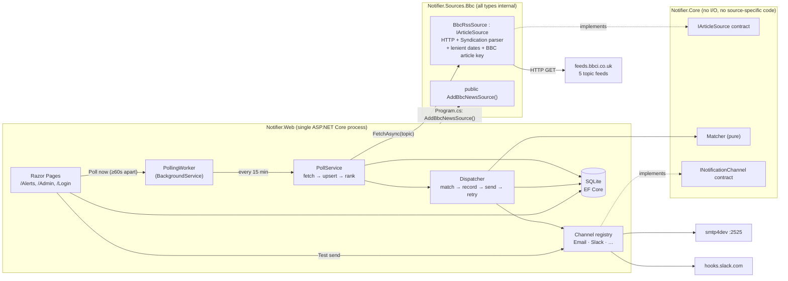
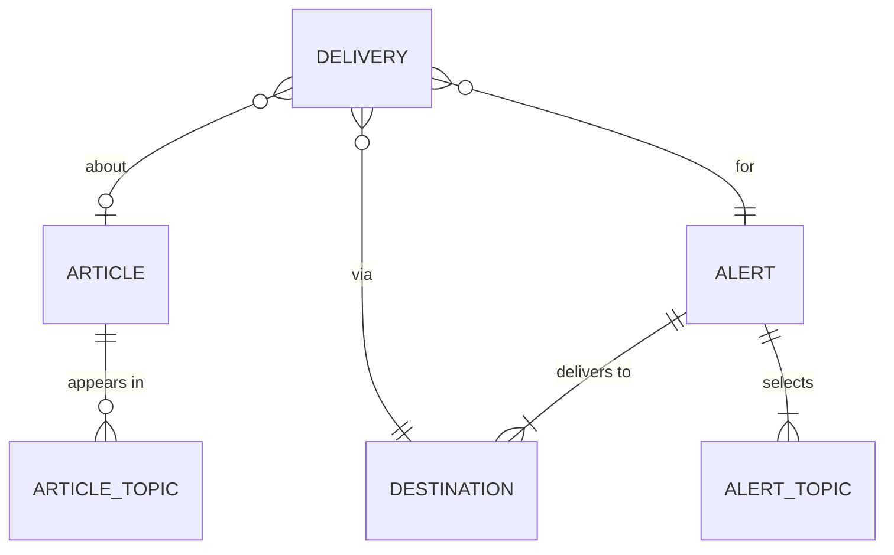

# 03: Design

Phase 3 · 2026-11-24 · Timebox 1h

**Inputs:**
- [02-requirements.md](02-requirements.md)
- [ADR 0001 stack](adr/0001-tech-stack.md)
- [spike findings](../notes/spikes/README.md)

**Companion ADRs:**
- [0002 importance model](adr/0002-importance-model.md)
- [0003 channel abstraction](adr/0003-channel-abstraction.md)

Story/NFR IDs in brackets show which requirement each design element serves.

## 1. Architecture

One ASP.NET Core process [NFR-10, NFR-11] hosts three things:
1. Razor Pages UI
2. Background poller
3. Delivery pipeline



**Why these projects** (revised after owner review, D-020 and D-021):
1. **Compiler-enforced boundary.** `Notifier.Core` references no ASP.NET,
   EF Core, MailKit, HTTP or Syndication code. The domain and matcher
   *cannot* accidentally depend on I/O.
2. **Testability.** Core is plain classes, so matcher tests need no host,
   database or HTTP fakes.
3. **Source isolation [NFR-03].** Core defines the `IArticleSource`
   *contract* (§4a). **Everything BBC-specific** lives in its own assembly,
   **`Notifier.Sources.Bbc`**:
   - the Syndication parser
   - the lenient date handling
   - the article-key rule (last URL segment)
   - the feed URLs and HTTP client setup

   All of it is `internal`. Its only public surface is
   `IServiceCollection.AddBbcNewsSource(IConfiguration)`. The compiler
   therefore stops Web code from touching BBC internals, not just a folder
   convention (D-021). The Syndication package dependency also leaves the web
   host.

   Swapping the source (licence risk, D-013) = replace one project reference
   and one line in `Program.cs`. **No changes to Core**, matcher, dispatcher
   or channels.
4. **Channel isolation [NFR-02].** Core defines `INotificationChannel`.
   MailKit/Slack code stays **in Web**, deliberately not in separate
   assemblies:
   - NFR-02 is about *adding* channels, which the interface already covers.
   - Nothing documented requires *swapping* a channel.
   - The source has that driver (the BBC licence risk); channels don't.

   This asymmetry is intentional (D-021).

> *Correction (V-026):* v1 of this design put `BbcFeedParser` and
> `ArticleKey` in Core and had **no** source interface. Swapping the source
> would have changed Core, contradicting NFR-03, even though the scripted
> trace reported NFR-03 as "covered".

## 2. Solution layout

```
Notifier.slnx
src/Notifier.Core/                 (no package references except BCL)
  Domain/        Topic, Tier, Article, Alert, Destination, Delivery, FeedStatus
  Sources/       IArticleSource, SourceItem, SourceFetchResult, SourceException
  Matching/      Matcher, MatchResult
  Channels/      INotificationChannel, ChannelField, Notification, SendResult
src/Notifier.Sources.Bbc/          (refs: Core, System.ServiceModel.Syndication, M.E.Http/DI abstractions)
  BbcRssSource (internal), BbcFeedParser (internal), BbcArticleKey (internal),
  BbcOptions (feed URLs, User-Agent), ServiceCollectionExtensions.AddBbcNewsSource (public)
  [assembly: InternalsVisibleTo("Notifier.Tests")]
src/Notifier.Web/                  (refs: Core, Sources.Bbc, EF Core SQLite, MailKit)
  Pages/         Login, Logout, Alerts/{Index,Create}, Admin/{Index,Alerts,Deliveries,Synthetic}
  Data/          NotifierDbContext (SQLite)
  Polling/       PollingWorker, PollService, PollTrigger
  Sending/       Dispatcher, TestSendService   (named Sending: a Delivery namespace would shadow the entity)
  Channels/      EmailChannel (MailKit), SlackChannel (HttpClient)
  Auth/          ConfigUserStore, login handler
tests/Notifier.Tests/
  Fixtures/      synthetic BBC-shaped RSS (no real BBC data, D-013 / V-014)
```

## 3. Domain model



| Entity | Fields | Constraints / notes |
|---|---|---|
| **Article** | `Key` (PK, string), `Title`, `Summary`, `Url`, `PublishedAtUtc?`, `FirstSeenAtUtc`, `LastSeenAtUtc`, `OnTopStories`, `TopStoriesRank?`, `IsSynthetic` | `Key` = last URL path segment, no query/fragment [A-02′]. `PublishedAtUtc` null when missing or unparseable (spike) |
| **ArticleTopic** | `ArticleKey`, `Topic`, `LastSeenAtUtc` | PK (ArticleKey, Topic). An article can be in several feeds (29/144 observed) |
| **Alert** | `Id`, `OwnerUsername`, `Name`, `Tier`, `Keyword?`, `Enabled`, `CreatedAtUtc`, `DeletedAtUtc?` | Every query filtered by owner [US-03]. **Soft delete:** deleting sets `DeletedAtUtc`. The alert disappears from the user's list and never matches, but its `Delivery` rows stay for the admin log (US-03; Q3 gap found in V-029) |
| **AlertTopic** | `AlertId`, `Topic` | ≥ 1 when Tier = All; none for Headline/FrontPage [US-02, Q1] |
| **Destination** | `Id`, `AlertId`, `ChannelKey`, `ConfigJson` | ≤ 1 per channel per alert in v1 (ADR 0003). Config holds secrets → never logged, masked in UI [NFR-06] |
| **Delivery** | `Id`, `ArticleKey?`, `AlertId`, `DestinationId`, `BatchId?`, `Kind` (Real/Test), `Status` (Pending/Sent/Failed), `Reason?`, `Attempts`, `LastError?`, `CreatedAtUtc`, `CompletedAtUtc?` | **Unique index (ArticleKey, AlertId, DestinationId)** = once-only guarantee [NFR-04]. Test sends have `ArticleKey` null; SQLite treats NULLs as distinct, so the index allows repeats |
| **FeedStatus** | `Topic` (PK), `LastPollAtUtc?`, `LastSuccessAtUtc?`, `LastError?`, `ItemsLastFetch`, `NewLastFetch`, `NextPollAtUtc?` | Drives admin status page [AS-02] (the baseline rule it once fed was rejected, Q5) |

**Enums:**
- `Topic`: TopStories, World, Business, ScienceEnvironment, Technology.
  Feed URLs come from config.
- `Tier`: Headline, FrontPage, All.

**Time:**
- All timestamps are `DateTime` in UTC from an injected `TimeProvider` [NFR-05].
- `DateTimeOffset` is deliberately avoided in entities, because the EF Core
  SQLite provider has limits on comparing/ordering it in queries. *(From
  memory; to verify in slice 1. Using UTC `DateTime` avoids the question
  either way.)*

**Schema creation:** `EnsureCreated()` at startup. No migrations for a
prototype with a disposable DB; documented as a production gap.

## 4. Importance and matching [US-05, ADR 0002]

`Matcher.Evaluate(alert, article, nowUtc, settings) → MatchResult(IsMatch, Reason, Rejection)`
is a pure function in Core, so it is table-testable.
- Topics come from `article.Topics`.
- `Rejection` names the first failing condition, so tests (and later the
  admin view) can tell *why* an article didn't match.

An article matches an alert when **all** of these hold:

| # | Condition | Source |
|---|---|---|
| 1 | `alert.Enabled` and not deleted (`DeletedAtUtc` null) | US-03 |
| 2 | `article.FirstSeenAtUtc > alert.CreatedAtUtc` | A-04′ (no backfill) |
| 3 | `article.PublishedAtUtc` is known **and** its age ≤ `FreshnessWindow` (24h), where age = `now − min(PublishedAtUtc, FirstSeenAtUtc)`. *The `min` was added in slice 5: without it a future-dated article stays fresh forever and breaks the retention invariant (§6a, V-061).* | A-04′, spike: unknown date ⇒ not eligible |
| 4 | **Tier = All:** the article appears in at least one of the alert's topics | A-09, Q1 |
| 5 | **Tier = FrontPage:** `OnTopStories` (any section). **Tier = Headline:** `TopStoriesRank ≤ HeadlineN` (5), where the rank exists only for the **lead section** (D-025). Topics are **not used** for these tiers | A-03′, Q1, D-025 |
| 6 | **Keyword** (optional): appears in `Title` or `Summary` as a **whole word or phrase**: case-insensitive, word boundaries on both ends, any whitespace between phrase words. *Was substring; changed after measuring noise on real feeds (D-026).* | A-09, D-026 |

**The tier decides; topics apply only to the All tier** (owner-accepted Q1,
ADR 0002).
- **Headline / Front page** alerts watch the BBC front page regardless of
  section. The create form disables the topic checkboxes for those tiers.
  The **keyword** narrows them (e.g. Headline + "Nvidia").
- **All** alerts need ≥ 1 topic.
- *Why not intersection (the AI's first default):* in the captured snapshot,
  only **2 of the top 5** and 11 of 33 Top-stories articles appeared in any of
  our four section feeds. Intersection would have silently missed most
  headlines (V-029).

**Reason text** goes into every notification [US-05]. It is source-neutral,
because Core must not know about the BBC (D-020); the source's attribution
("Source: BBC News") is added separately:
- "#2 in Top stories" (Headline, or Front page within the lead section)
- "In Top stories" (Front page, later section)
- "New in Technology" (All: the first shared topic in topic order)
- Plus " · keyword: 'nvidia'" when a keyword matched.

## 4a. Source contract [NFR-03]

```csharp
public interface IArticleSource
{
    string Attribution { get; }               // "Source: BBC News" → every notification [NFR-07]
    IReadOnlyList<Topic> SupportedTopics { get; }
    Task<SourceFetchResult> FetchAsync(Topic topic, CancellationToken ct); // throws SourceException
}
public sealed record SourceItem(
    string Key,                 // source-defined stable identity (BBC: last URL path segment)
    string Title, string Summary, Uri Url,
    DateTime? PublishedAtUtc,   // null = missing or unparseable → never eligible
    int Section,                // 0-based feed section; 0 = lead section (D-025)
    int Position);              // 0-based order within the section
public sealed record SourceFetchResult(Topic Topic, IReadOnlyList<SourceItem> Items);
```

- The poll service sees only `SourceItem`s. It knows nothing about RSS,
  GUIDs or BBC URL shapes.
- **Contract assumption:** a replacement source must offer a ranked
  `TopStories` list for the Headline / Front page tiers to work. A source
  without one would support only the **All** tier. This is stated rather than
  hidden.
- **Out of scope (v1):** several sources at once. DI registers exactly one
  `IArticleSource`. Multi-source would need source-scoped keys, which is the
  cross-source merge non-goal.

## 5. Poll cycle [NFR-01, AS-02, AS-06]

```mermaid
sequenceDiagram
  participant W as PollingWorker
  participant P as PollService
  participant B as BBC feeds
  participant DB as SQLite
  participant D as Dispatcher
  W->>P: tick (15 min) or Poll now
  loop each of 5 topics (sequential)
    P->>B: GET feed (UA identifies prototype, 20s timeout)
    alt success
      P->>P: parse (lenient dates), ArticleKey per item
      P->>DB: upsert Article + ArticleTopic (FirstSeen only on insert)
      P->>DB: FeedStatus ok, counts
    else HTTP / parse error
      P->>DB: FeedStatus error (other feeds continue, A-14)
    end
  end
  P->>DB: if Top stories succeeded: OnTopStories for every item; rank = Position+1 for lead-section items only; clear both for absent articles
  P->>D: candidates = articles seen this cycle
  D->>DB: Pending deliveries (unique index skips duplicates)
  D->>D: send via channel, 1 retry on failure
  D->>DB: Sent / Failed + error
```

**Rules** (each found to be necessary during analysis or spikes):

1. **Batching instead of a baseline poll** (owner, D-023; replaces the
   rejected Q5).
   - All matches from one cycle are grouped per (alert, destination) and sent
     as **one message** (§6).
   - This covers the flood edge cases without skipping anything:
     - first successful poll after the BBC was unreachable
     - a newly added feed
     - a reset article table
   - It also tames busy **All** alerts.
2. **Ranks change only after a successful Top stories fetch.** A failed
   fetch must not wipe every rank, and must not cause false
   "dropped off the front page" changes.
   - **Only the lead section is ranked** (D-025). A BBC feed concatenates page
     modules, and the GUID `#n` marks the module (V-048). Position is only a
     ranking *inside* the lead module.
   - Items in later sections are `OnTopStories` (Front page tier) but have no
     rank, so a short lead section can't let a lower module's items into the
     Headline tier.
3. **FirstSeen is set on insert only.** Updates refresh title/summary/rank
   and `LastSeenAtUtc`.
4. **Upward rank moves re-trigger matching** [A-04′]. Candidates are
   re-evaluated every cycle. The unique index makes repeats harmless.
5. **Poll now** [AS-06]:
   - The page writes to a bounded `Channel<PollRequest>` (capacity 1, drop
     when full).
   - The worker waits on *either* the 15-min timer or that channel.
   - The 60 s minimum gap is enforced with `TimeProvider`, and the page shows
     "next allowed at …".
   - The worker also waits until 60 s after the **previous cycle started**.
     Without that, a request arriving mid-cycle would trigger a second set of
     BBC fetches seconds after the first (V-063).
6. **Polite polling** [D-013]:
   - interval ≥ 15 min (config validation rejects less for live BBC)
   - honest `User-Agent` naming a personal, non-commercial prototype
   - sequential requests
   - no article page fetches

## 6. Delivery [US-05, NFR-04, ADR 0003]

1. For each (match × destination), **insert a `Delivery` row as Pending
   first**. A unique-constraint conflict means "already handled", so skip it.
   The once-only guarantee therefore stays **per article**, even though
   sending is batched.
2. **Group** this cycle's new Pending rows, plus Pending rows left over from
   a crash, by **(AlertId, DestinationId)**. Each group gets a new `BatchId`
   (GUID) on its rows.
3. Build one channel-neutral `Notification` per group (contract §7):
   - `Items`: one entry per article (Title, Summary, Url, Reason)
   - `AlertName`
   - `Attribution` taken from `IArticleSource.Attribution` ("Source: BBC
     News"), not hard-coded
   - flags `IsTest`, `IsSynthetic`
   - **Cap:** at most **20 items** per message, then `MoreCount` ("…and N
     more"). Rows beyond the cap are still marked Sent with the same batch,
     because the user was told they exist and they must not re-send later.
4. `channel.SendAsync(notification, config)`. On failure, **retry once**
   after 2 s. Then mark **all rows of the batch** Sent or Failed together,
   with the error after masking secrets.
5. **Crash safety:** rows still Pending (process died mid-send) are
   re-grouped and sent on the next cycle, using the **`Reason` stored on the
   row** (the article may no longer match by then). That makes delivery
   **at-least-once with a tiny duplicate window**, chosen over at-most-once,
   which would silently lose alerts. **Owner-accepted (Q4).**
6. *Not a digest:* grouping happens **within one poll cycle only**. There is
   no timed accumulation. Scheduled digests remain a non-goal (02 §5).

## 6a. Retention [NFR-08: Must since D-023]

**Invariant:** delete only data that can **no longer cause a match**.
Matching needs `now − PublishedAtUtc ≤ FreshnessWindow` (24 h), so nothing
deleted below can make an article "new" again or re-send it.

| Data | Deleted when (defaults, configurable) | Why it's safe |
|---|---|---|
| `Delivery` | `CreatedAtUtc` older than **30 days** | Covers articles published > 30 d ago. They fail freshness forever, so losing their unique-index row can't cause a re-send |
| `Article` + `ArticleTopic` | `LastSeenAtUtc` older than **FreshnessWindow + 7 d** *and* no remaining `Delivery` rows | Uses **last seen**, not published. An article still in a feed (items stay for months, V-011) keeps being "seen" and is never deleted, so it can't come back with a new `FirstSeen` |
| Soft-deleted `Alert` (+ topics, destinations) | `DeletedAtUtc` set *and* no remaining `Delivery` rows | History first, then the alert |
| `FeedStatus` | Never | 5 fixed rows |

- **When:** at the end of each poll cycle (a cheap indexed delete).
- **Startup validation:** both windows must be longer than
  `FreshnessWindow`, or the app refuses to start. A misconfiguration can't
  break the invariant.
- **Why Must:** D-013 adopted "minimal retention" as a BBC-terms safeguard.
  Leaving it as Could contradicted that decision (V-030). Batches need no
  retention of their own: `BatchId` is a column on `Delivery`.

**Test send** [US-04]: the same path with a fixed sample notification marked
"TEST". It is recorded as `Kind=Test` and the result is shown on the page.

**Synthetic article** [AS-07, Should]:
- The admin creates an `Article` with `IsSynthetic=true`, chosen topic and
  rank, `FirstSeen=now`, `Published=now`.
- The dispatcher runs for that article only.
- Notifications are prefixed "[SYNTHETIC]".

## 7. Channels [NFR-02, ADR 0003]

```csharp
public interface INotificationChannel
{
    string Key { get; }                                   // "email", "slack"
    string DisplayName { get; }
    IReadOnlyList<ChannelField> ConfigFields { get; }     // drives the generic form
    IReadOnlyList<string> Validate(IReadOnlyDictionary<string, string> config); // errors
    string Describe(IReadOnlyDictionary<string, string> config);                // masked, for UI
    Task<SendResult> SendAsync(Notification n, IReadOnlyDictionary<string, string> config, CancellationToken ct);
}
public sealed record ChannelField(string Name, string Label, FieldKind Kind, bool IsSecret);
public sealed record NotificationItem(string Title, string Summary, Uri Url, string Reason);
public sealed record Notification(
    string AlertName, IReadOnlyList<NotificationItem> Items, int MoreCount,
    string Attribution, bool IsTest, bool IsSynthetic);   // Items.Count >= 1; batching = Items.Count > 1
```

- **Registry:** `IEnumerable<INotificationChannel>` from DI, indexed by
  `Key`.
- **Adding a channel:** one class + one `AddSingleton<INotificationChannel, X>()`.
  The create-alert form renders each channel's `ConfigFields` generically, so
  no page, matcher, dispatcher or entity changes are needed.

| | Email | Slack |
|---|---|---|
| Config | `address` (Email) | `webhookUrl` (Url, **secret**) |
| Validation | `MailboxAddress.TryParse` | `https`, host exactly `hooks.slack.com`, path starts `/services/`: SSRF guard [US-02] |
| Masking | `j***@example.com` | `https://hooks.slack.com/services/T…/****` |
| Format (1 item) | Plain text. Subject `[Notifier] {Reason}: {Title}` with **CR/LF stripped** (spike V-023). Body: title, summary, reason, link, attribution | JSON `{"text": …}` with link + attribution. Escape `&`, `<`, `>` *(Slack escaping rule from memory: verify in slice 4)* |
| Format (batch) | Subject `[Notifier] {n} new stories for '{AlertName}'` (CR/LF stripped). Body: numbered list of title, reason, link; then "…and N more" if capped; attribution once | One message, one line per item (title linked, then reason), then "…and N more" and the attribution. Must stay within Slack's message-length limit *(limit from memory: verify in slice 4; the 20-item cap is the guard)* |
| Transport | MailKit 5 `SendRequest` → SMTP host/port from config (smtp4dev 2525 locally) | `IHttpClientFactory` client, 10 s timeout, **no auto-redirect** (SSRF) |
| Errors | SMTP exception message | Non-2xx status + response body text |

Neither channel sends images or BBC logos [NFR-07].

**Slack facts verified from Slack's docs (slice 4):**
- **Escaping:** only `&`, `<` and `>` need escaping, as HTML entities.
- **Length:** keep `text` ≤ 4,000 characters (it may be split above that;
  truncated at 40,000). The batch format therefore fills items until a
  4,000-character budget is reached and moves the rest into "…and N more".
  The Slack batch also omits summaries.
- **Errors:** webhook error status codes are only documented in a 2016
  changelog. The channel treats **any** non-2xx response as a failure and
  records the body text.
- **Unfurling:** the payload sets `unfurl_links`/`unfurl_media` to false, so
  Slack doesn't pull BBC preview images.
- **Still unverified:** that incoming webhooks honour the `unfurl_*` fields
  (documented for `chat.postMessage`), and that Slack decodes `&amp;`
  inside link URLs. No real Slack workspace has been tested; it needs a
  webhook URL from the owner.

## 8. UI pages and access [US-01…04, AS-01…07]

| Page | Access | Stories | Pri |
|---|---|---|---|
| `/Login`, `/Logout` | anonymous / any | US-01, AS-01 | Must |
| `/Alerts` list: enable/disable, delete (confirm), "Test" per destination | user (own alerts only; foreign id → 404) | US-03, US-04 | Must |
| `/Alerts/Create`: name, topics (checkboxes), tier, keyword, one optional block per registered channel | user | US-02 | Must |
| `/Admin`: feed status table + **Poll now** | admin | AS-02, AS-06 | Must |
| `/Admin/Alerts`: all alerts, masked | admin | AS-04 | Should |
| `/Admin/Deliveries`: filter by status, failures highlighted | admin | AS-05 | Should |
| `/Admin/Synthetic`: inject article | admin | AS-07 | Should |

- **Authorization by convention:**
  - `AuthorizeFolder("/")`
  - `AllowAnonymousToPage("/Login")`
  - `AuthorizeFolder("/Admin", "AdminOnly")`
- Non-admins hitting `/Admin` get **403** [US-01].
- **Antiforgery** tokens are on for all POSTs (framework default).
- **Keyword validation on create** (code review, V-053): trimmed, ≤ 100
  characters, and it must contain at least one letter or digit. A
  punctuation-only keyword would only match standalone punctuation, which is
  meaningless.
- **No "edit alert"** in v1: requirements only ask for create, list,
  enable/disable and delete. Edit = delete + create.

## 9. Auth and configuration [NFR-06, NFR-12]

- **Users** come from `Notifier:Users` config, each with `Username`, `Role`
  (User/Admin) and `PasswordHash`.
  - Hashes are produced with ASP.NET Core's `PasswordHasher<T>` (PBKDF2).
  - Hard-coded per A-01. Dev passwords are documented in the README as
    **dev-only**.
- **Cookie auth:** `HttpOnly`, `SameSite=Strict`, 8 h sliding expiry.
- **Secrets** (SMTP credentials if any, a real Slack webhook for the demo)
  come from user-secrets or env vars, never `appsettings.json`.
- **Settings:**
  - `PollInterval` (min 15 min live)
  - `FreshnessWindow` (24 h)
  - `HeadlineN` (5)
  - `ManualPollMinGap` (60 s)
  - feed URLs
  - SMTP host/port
  - DB path

## 9a. Running locally [NFR-10]

*Added after a manual NFR read-through (V-027): v1 of this design needed two
manual steps, and never said how smtp4dev gets installed.*

- **`dotnet-tools.json`** at the repo root (local tool manifest; the .NET 11
  SDK's default location, not `.config/`) pins
  `rnwood.smtp4dev` **3.15.0**. `dotnet tool restore` installs it per repo,
  not globally. This is the same version verified in the spike.
- **`run.ps1`** is the one documented command. It:
  1. runs `dotnet tool restore`
  2. starts smtp4dev in the background (`--smtpport=2525 --urls=http://localhost:5080 --db=""`)
  3. runs `dotnet run --project src/Notifier.Web`
  4. stops smtp4dev when the app exits
- **Without the script**, the README lists the two manual commands.

## 10. Testing strategy [NFR-09]

| Level | What | How |
|---|---|---|
| Unit (Sources.Bbc, via `InternalsVisibleTo`) | `BbcArticleKey` normalization (articles/videos/weather paths, query, fragment) | xUnit `[Theory]` |
| Unit (Sources.Bbc, via `InternalsVisibleTo`) | `BbcFeedParser` → `SourceItem`s: order/Position, UTC, missing/garbage dates → null, missing guid | Synthetic RSS fixtures in BBC's shape |
| Integration (Web) | Poll cycle runs against a **fake `IArticleSource`**: also shows the source is swappable [NFR-03] | In-memory fake returning `SourceItem`s |
| Unit (Core) | `Matcher`: every condition in §4, each tier boundary (rank 5 vs 6), freshness edge, keyword case, reason text | Table-driven; **mutation spot-check** (flip a condition, confirm a test fails) |
| Integration (Web) | Poll cycle: new article sends once → next poll sends nothing → article climbing into top 5 sends once | Fake `HttpMessageHandler` serving fixtures, SQLite in-memory, `FakeTimeProvider` |
| Integration (Web) | Dispatcher: unique index blocks duplicates; one retry; Pending rows resumed **and re-batched**; 3 matches → **one** send with 3 items; 25 matches → 20 items + `MoreCount=5`, all 25 rows Sent | Fake channel |
| Integration (Web) | **Retention invariant:** purge, then re-poll the same feed → nothing re-sent; article still in feed is not purged; config with window ≤ freshness fails at startup | `FakeTimeProvider` advanced past the windows |
| Integration (Web) | **Extensibility proof** [NFR-02]: register a test-only channel, run the dispatcher, no core changes | Fake channel in test DI |
| Manual E2E | Real BBC poll, smtp4dev inbox, real Slack webhook if available | Screenshots → `notes/screenshots/` |

`FakeTimeProvider` comes from `Microsoft.Extensions.TimeProvider.Testing`
*(package name from memory: verify in slice 1)*.

## 11. Could items: design notes (build only if ahead)

| Item | Design |
|---|---|
| US-06 notification history | `/Alerts/History`: the user's own `Delivery` rows joined to Article/Alert. No new data needed |
| AS-03 recent articles | `/Admin/Articles`: Article + ArticleTopic, ordered by `FirstSeenAtUtc`. No new data |
| AS-08 retry failed delivery | Button on `/Admin/Deliveries`: reset a Failed row to Pending; the next dispatcher pass picks it up (reuses §6 resume) |

All three reuse the existing model, so deferring them costs nothing
structurally. *(NFR-08 retention moved to §6a as Must, D-023.)*

## 12. Owner decisions on AI-proposed design choices (prompt 027)

| # | Question | Decision |
|---|---|---|
| Q1 | How do topics and tier combine? | ✅ **Tier decides; topics only for All** (the AI's intersection default was refuted by data, V-029) |
| Q2 | Destinations per alert | ✅ ≤ 1 per channel (≤ 1 email + ≤ 1 Slack); the model supports N |
| Q3 | Edit alerts? | ✅ No edit in v1, **plus soft delete** to keep delivery history (gap found while explaining Q3) |
| Q4 | Crash semantics | ✅ At-least-once (rare duplicate over silent loss) |
| Q5 | Baseline poll sends nothing | ❌ **Rejected by owner.** Replacement under discussion: batch several matches into one message (§5 rule 1) |

## 13. Build slice mapping (from plan.md)

| Slice | Design sections |
|---|---|
| 1 Skeleton, model, auth | §2, §3, §9 |
| 2 BBC adapter | §3 Article, §5 rules 1–3, spike constraints |
| 3 Matcher | §4 |
| 4 Channels + test send | §6 test send, §7 |
| 5 Poller + dispatcher | §5, §6 |
| 6 User pages | §8 |
| 7 Admin Must | §8 `/Admin`, §5 rule 5 |
